# Cartur's Map Pins

Pins things onto your map as you come across them, with a name and an icon, so you can find your way back without writing anything down.

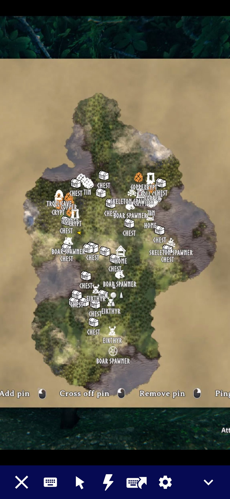

## What it does

Walk within `DiscoveryRadius` (60 metres by default) of an ore deposit, a crypt entrance, a wild beehive or an abandoned chest and it lands on your map with a name on it. The pins are saved with your character like hand-placed ones. They stay after you clear the node, so you can cross them off yourself, with a few exceptions listed below.

The pinned categories are ore deposits, dungeon and cave entrances, camps and villages (Fuling villages, Charred fortresses, abandoned villages and farms, the Deep North village), wild beehives, runestones, abandoned chests, buried chests, named minibosses, leviathans, traders, maypoles, boss altars, high-value pickables and your bed, marked as home. Every category has its own switch. Some are off in a fresh install: landmarks (wells, shipwrecks, stone circles and similar), lore runestones, spawners, wisp spawners, and Greydwarf camps. Within pickables, only the high-value group is on. Berries and mushrooms, crops and herbs, branches, stones and flint, and unrecognised pickables are off, because they would cover the map and bloat your save. Vanilla already marks boss altars with an unnamed icon that is not saved. This mod's pin replaces it rather than sitting on top.

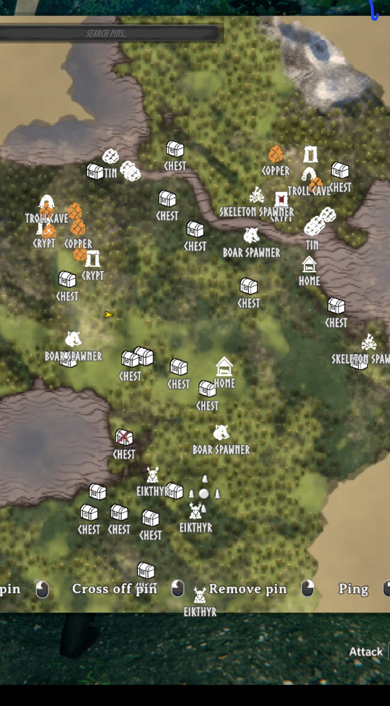

Some pins follow the thing instead of marking a spot. Your boats and carts, tames you have named, anything you can ride, and bears are tracked. When the game does not have the thing loaded, the pin stays where you last saw it. Unnamed livestock is not tracked. These are under `Tracking` in the config.

A few pins tidy themselves. An ore pin is removed once the deposit is mined out, since deposits never respawn. A looted chest switches to an open-chest icon and fades to half opacity, and goes back if the chest is refilled. A dungeon pin is ticked off once every chest inside is empty and every mud pile is mined. When you loot your grave, its death marker is removed too.

## Changing a pin's icon

Shift-click any pin on the large map to open an editor beside it. You can rename the pin, pick a different icon, choose a colour, and set its size and opacity. It works on pins this mod placed and on ones you placed by hand. There are 158 icons, and every category and kind of thing takes its own.

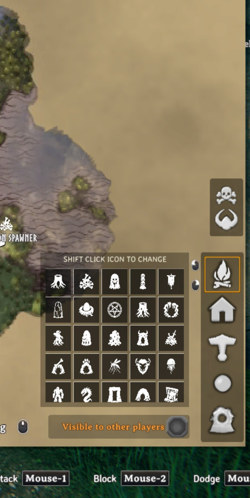

There is also an icon grid on the large map next to vanilla's pin buttons, for choosing what a hand-placed pin will look like. Drag the small gold square in its top left corner to move the panel. It stays where you put it. Only the square drags, so clicking an icon still picks the icon.

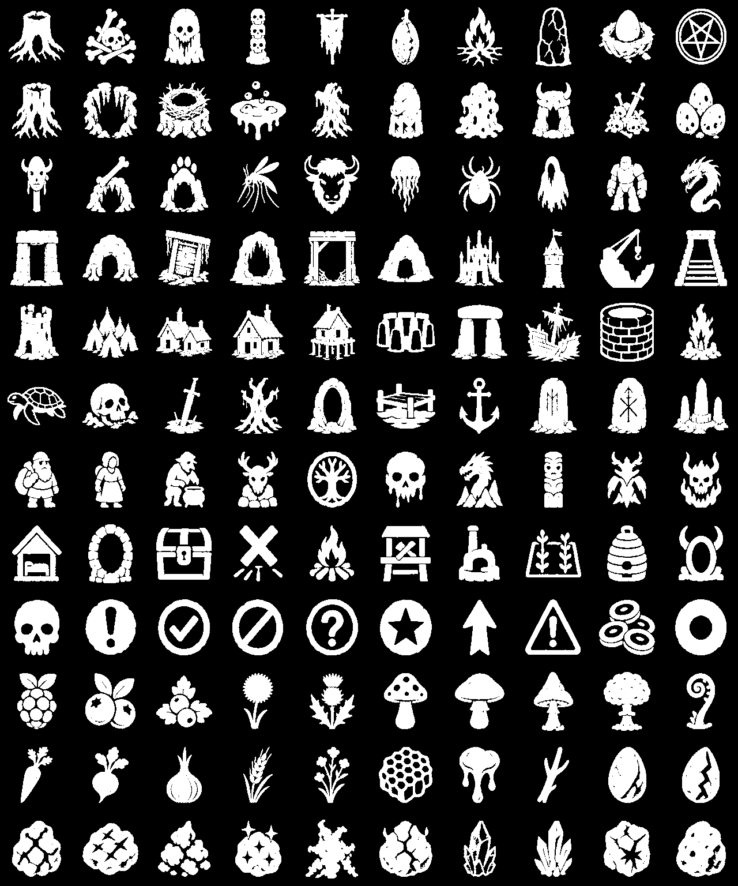

## Hugin helps you set it up

The first time you load a world after installing or updating, Hugin lands and offers to choose what gets pinned. Talk to him and a menu opens: one page for each kind of place (ores, dungeons, camps and villages, bosses, berries and things to pick, landmarks, creature spawners, everything else). Every item has a tick, its icon, its colour and a hover description that says what it is and where it is found. **Select all**, **Deselect all** and **Undo** work on the page you are on. The first page chooses who sees your pins at the cartography table, turns **New default colours** on or off, and has links to the rest of Cartur's mods.

The menu opens on your own settings, and pressing Done writes only what you changed, so updating never touches a setup you already made. **Not now** changes nothing. `carturpins_setup` opens it again at any time. If you play with the game's tutorials switched off, Hugin does not land; use the command.

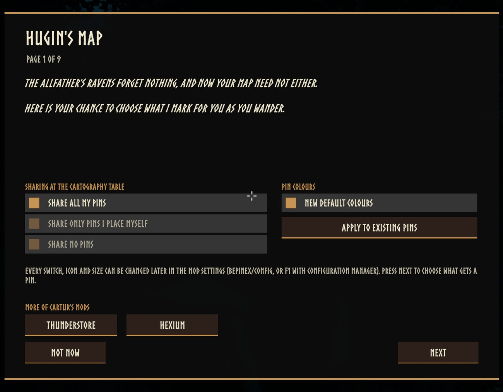

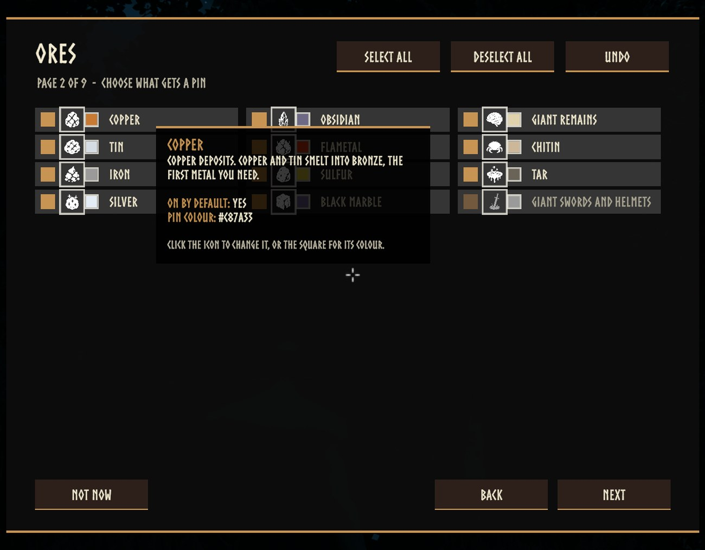

## Colours

Shift-click a pin and the editor has a **colour wheel**, a brightness bar, your **last five colours** and an Original button. The same wheel is in Hugin's menu, beside every item.

With **New default colours** on (`General / NewDefaultColours`), every new pin takes the colour of the thing it marks: copper brown, tin pale, each berry its own colour, a Fuling village orange, Eikthyr lightning blue, and so on, a colour for every kind. Only pins placed from then on are affected. The **Apply to existing pins** button in Hugin's menu (or `carturpins_applycolours`) gives the pins already on your map the same colours, leaving any colour you chose yourself. Every kind's colour is a setting of its own under *Kind Colours*, as a hex code.

Opacity works the same way. Click the percentage next to a kind's colour in Hugin's menu to step it through 100, 75, 50 and 25; it is saved when you press Done, applies to new pins, and **Apply to existing pins** applies it to pins you have not faded yourself. Each kind's opacity is a setting under *Kind Opacity*.

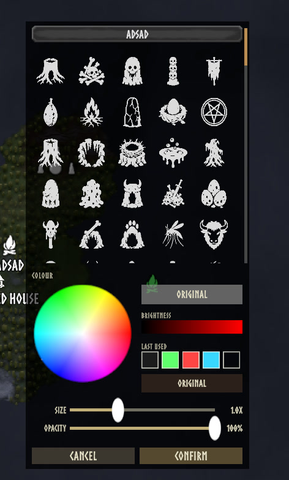

## On the map screen

- **Hide pins with H.** Each press steps through All Pins, Mine Only (the ones you placed), Auto Only (only the ones this mod placed), None, and back to All. Names go with the pins. Nothing is deleted. The key is a setting (`General / HidePinsKey`), and the bottom bar always says which state you are in now.
- **Hide names with Shift+H.** Switches every pin's name off and on again and leaves the icons alone. Point at a pin and its name shows. The bottom bar says **Labels On** or **Labels Off**. It lasts until you quit the game. The key is a setting (`General / HideLabelsKey`).
- **Setup with P.** Opens Hugin's setup menu from the large map, the same as `carturpins_setup`, so it works when Hugin is not around. The bar shows it as **Setup**. The key is a setting (`General / SetupKey`).
- **Point at a pin and its name wins.** Any other name that would overlap it fades out while the cursor stays on the icon, and comes back when you move off.
- **The icon picker** has a top bar you can drag anywhere, with **Visible to other players** in it. The game's own pin buttons and Epic Loot's sit in the picker now instead of in columns down the edge, and a favourite star on each icon puts it in a **Favourites** row at the top, above a **Recent** row. The old icon set is folded away until you open it.
- **Shift-click** works on your spawn point and your last death too, for colour, size and opacity. The hint bar shows it as **Shift + click, Change Icon**.
- **The wheel zooms smoothly, about the pointer.** One notch is 25% (the game's own is 10%) eased over 60 ms, and the spot you point at stays under the pointer until the world fills the view. Hold Shift for 2% a notch. The M and Z keys, a controller and touch use the game's own zoom, unchanged. `SmoothMapZoom` turns it off; the step, the time, the Shift step and key, and the pointer anchoring are settings (below).
- Pins and names fade rather than flicker or jump.

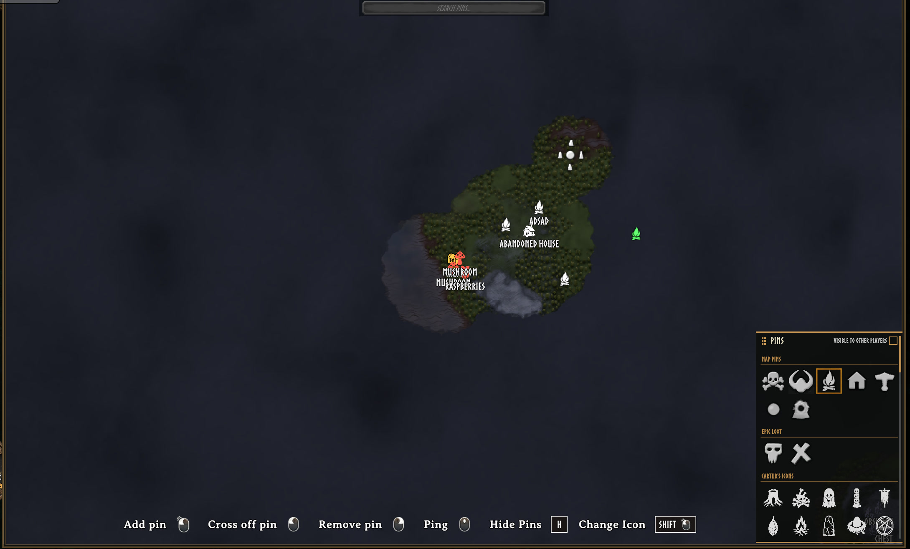

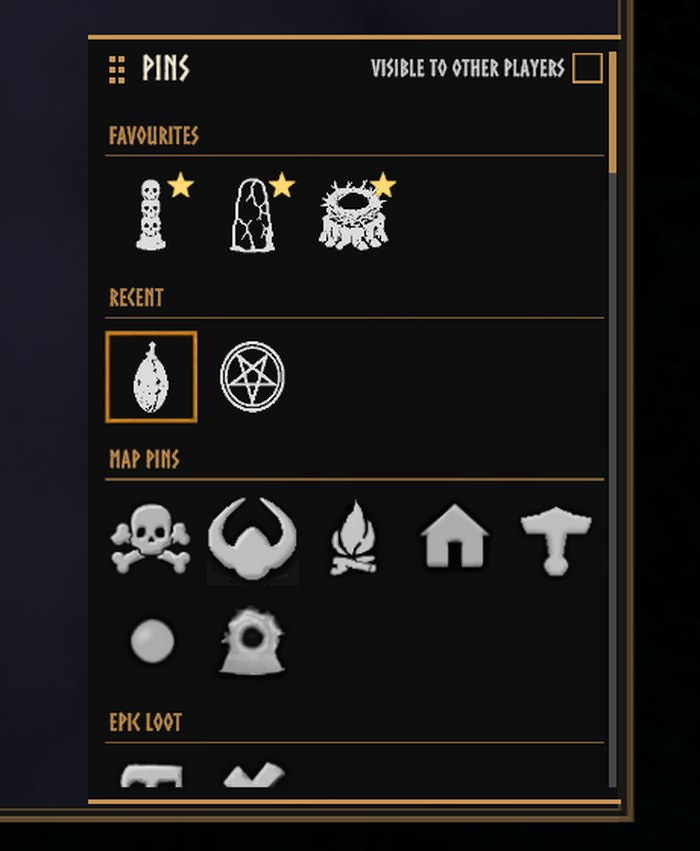

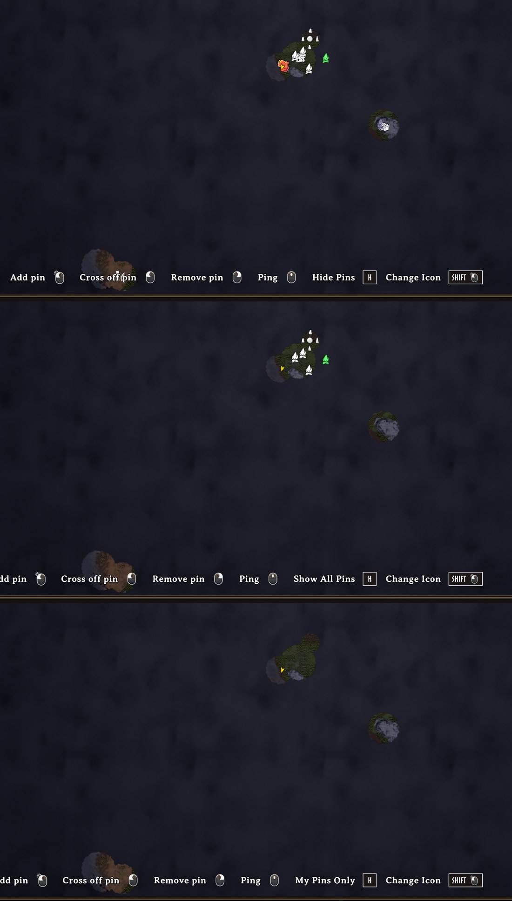

## Portals

Every portal is pinned, named with the tag you gave it. Built without a name it starts as "Portal" and takes its name the first time you name it.

## Groups and zooming out

Both are off by default.

- **`General / ClusterPins`:** pins this mod placed that crowd together and share an icon become one pin with a count badge (a plain ring for 2 to 9, a heavier one for 10 to 99, gold for 100 or more). The others fade out where they are; nothing moves. Hover the badge for a list of what it stands for and how far away it is. Click it to open a list of the pins in it, nearest first, that you can search and scroll; click one and the map glides to it at a zoom where it stands alone. The list only reads: it does not tick, rename or delete anything. Click outside it to put it away; Escape closes the map as it always does, and the list with it. `ClusterClickAction = Zoom` brings back the old click, which zooms in. A badge cannot be ticked off or deleted until you are down to a single pin. Your own pins and other players' pins are never grouped.
- **`General / MixedCategoryClusters`:** off by default. Lets crowded pins of different kinds share one badge: ore with chests and stones, landmarks with props and nests, pickables with each other. Bosses, dungeons, camps, traders, home and portals never join a mixed badge, and neither do your own pins. A mixed badge has a teal ring, and its list says how many of each kind are in it.
- **`General / EnableClusterSpiderfy`:** off by default. With `ClusterClickAction` set to Spiderfy, clicking the badge of a small cluster (up to `SpiderfyMaxPins`, 12) fans its pins out on a ring round the badge, on thin lines back to where they are; click one to go to it. Any zoom, drag or click elsewhere puts them away. Bigger clusters open the list. Mouse only.
- **`General / PriorityZoomOut`:** when the map is zoomed far out, pickables drop first, then landmarks, nests and hives, then ore, chests and stones. Bosses, dungeons, camps, portals, traders and home always stay.

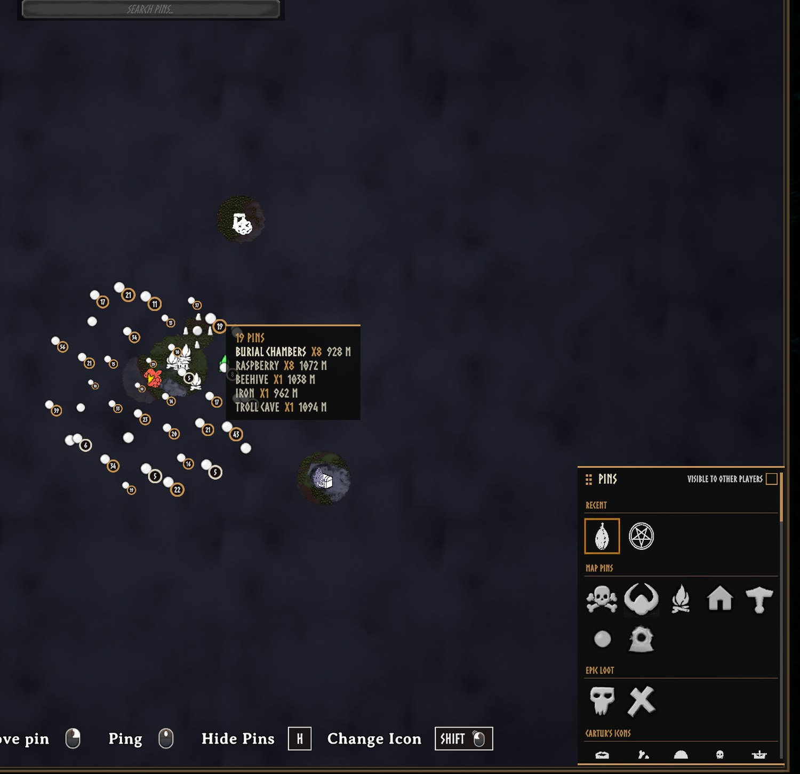

## Keeping the map readable

An ore field is a dozen separate deposits, which used to be a dozen identical pins in one white blob. Pins with the same name on the same patch of the map now draw as one, and separate again as you zoom in. Nothing is deleted. Every pin is still on the map, still saved and still searchable.

Pins are drawn at 75% of the game's size when zoomed in, keep that until the map is 15% zoomed out, and shrink to 70% of it (about half the game's size) at the whole-world view. Pin names stop being drawn once the map is zoomed out past `HideLabelsFromZoom` (63 by default, about where "20% of the way out" was before 2.2); past that, pointing at a pin shows its name. Both points are settings and both can be turned off. Pins that sit on top of each other shrink, never below half size, and where two names overlap the rarer one is kept, so CRYPT beats CHEST. Pointing at a pin always shows its name. Sizes and fades change smoothly rather than popping.

When two names would overlap, the one that loses is tried above its icon, then to the right, then to the left, before it is hidden (`SmartLabelPlacement`); it goes back under the icon once that place is clear again. Bosses, dungeons, camps, traders, home and portals claim name space before the common kinds do. Names go, and come back, one wheel notch after the zoom limit.

You can draw pins with no names at all, so the map reads as icons. The names stay searchable, they just are not drawn. You can also stop drawing pins further than a set distance from your character. That is off by default. The `HiddenPins` setting takes a list of names to hide without deleting the pins, and its settings row has a list to pick from your own map.

Type in the search box across the top of the map and everything that does not match fades, so you can see where the copper is without losing the shape of the map.

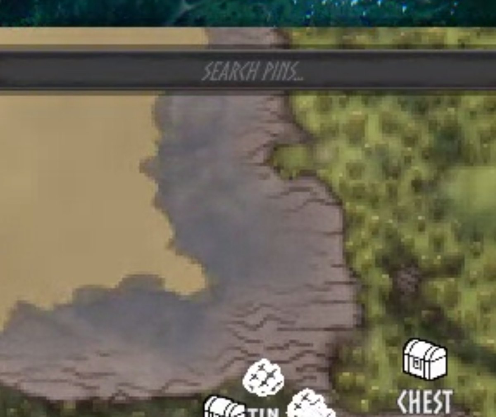

## Your own short labels

If you keep a compact naming convention such as R5, B7, SC or FC, write it in `BepInEx/config/carturpins_labels.txt`, one kind per line:

```
Pickable:Raspberry=R{qty}
Dungeon:Sunken Crypt=SC
Ore:Copper={qty} {name}
```

`{qty}` is how many pins of that kind are merged into the marker at the current zoom, and is left out when there is just one. `{name}` is the normal name in your language. The file is written for you the first time you start the game, with every line commented out. The key of any pin is the first field of its line in the `.pins.txt` record in `BepInEx/config`. Changes apply the next time you load a world.

Only what is drawn changes. The saved name stays, so search, the rename box and the pin list still read "Sunken Crypt". Pins you renamed yourself keep your name, and pointing at a pin shows its full name. The labels are yours alone. Other players only see them if they use the same file.

## Names and languages

Names are stored as the game's own localisation tokens, so a crypt reads "Burial Chambers" in your language and is re-worded if you change language. A pin you renamed yourself is left alone. Names the mod makes up itself, such as Sunken Crypt, Frost Cave and Fuling Village, translate through `carturpins_names_<language>.txt`. `carturpins_names_english_template.txt` is written to `BepInEx/config` the first time you start the game. Copy it to `carturpins_names_french.txt` (or `german`, `spanish`, and so on: the game's own language name), translate the text after each `=` and restart the game. The same file translates the names and descriptions in Hugin's setup menu (`carturpins_desc_*` and `carturpins_row_*`; page titles, buttons and the welcome text are not translated) and the name shown when you point at an icon in the icon pickers (every icon name has a key, in the template; icons the game already has a word for, such as Resin or Workbench, follow the game's language when you have no file). An older template gets the new keys appended the next time the game starts. `carturpins_labels.txt` is for short labels, not translation.

What counts as ore, a beehive or a pickable is worked out at runtime from components rather than from a list of prefab names, which is why it should survive game updates and pick up modded content. Player-built beehives and containers are never pinned.

## Settings

Config file: `BepInEx/config/com.jekkle.valheim.carturmappins.cfg`.

In the config manager (F1) the settings are in numbered sections, and the first one, **01. Start Here**, has a button, **Open Hugin's setup**. The setup menu is where what gets a pin, its icon, its colour and its opacity are chosen, plus who sees your pins at the cartography table and New default colours, so none of those are listed in F1. They are still in the `.cfg` file under the same names and values, and editing them there works as before. The button needs a world to be loaded, and closes the config manager so the menu is not hidden behind it. P on the large map and `carturpins_setup` open the same menu.

| Setting | Default | What it does |
| --- | --- | --- |
| `DiscoveryRadius` | 60 | Metres. How close you must get before something pins. |
| `AutoPinning` | true | Place pins automatically. Off pauses it without touching any category switch. |
| `AutoPinningKey` | F8 | Key that toggles `AutoPinning` in game. |
| `ShowPinLabels` | true | Draw the name under each pin this mod places. Your own pins keep their names. |
| `HideCollidingLabels` | true | Stop names being drawn on top of each other. |
| `HideGroupedLabels` | true | No name on a pin that stands for several (cluster badge, merged repeat) once the map is zoomed out past half of `HideLabelsFromZoom`; point at it and the name shows. A pin that is only crowded keeps its name unless it overlaps another. |
| `LabelScale` | 0.7 | How big names are drawn, 0.3 to 2. 1 is the game's own size. Applies at once. |
| `HideLabelsFromZoom` | 63 | The zoom past which names stop being drawn. 0 is fully zoomed in, 100 is the whole world and never hides. The scale is logarithmic: every point is the same step of zoom, one wheel notch is about 1.4 points, and a value from before 2.2 is converted for you the first time the map opens (2 becomes 20, 20 becomes 63). |
| `SmartLabelPlacement` | true | A name that would overlap another is tried above, right and left of its icon before it is hidden. |
| `SmoothMapZoom` | true | Ease the large map's wheel zoom and zoom about the pointer. Off gives the game's own zoom back. |
| `MapZoomStepPercent` | 25 | One wheel notch, in percent (the game's own is 10), 1 to 50. |
| `ZoomPreset` | None | A button: Smooth (6% over 160 ms), Fast (25% over 60 ms) or Explorer (50% over 60 ms) sets the step and the time, then returns to None. |
| `PrecisionZoomPercent` | 2 | One notch while the precision key is held, 1 to 10. |
| `PrecisionZoomKey` | LeftShift | Hold for the finer step. Right Shift also counts when this is Left Shift. |
| `MapZoomDurationMs` | 60 | Time to cover 98% of a zoom, 0 to 600. 0 zooms at once. |
| `CursorCenteredZoom` | true | Zoom about the pointer instead of the middle of the map. |
| `ShrinkPinsFromZoom` | 15 | Percent zoomed out before pins start shrinking. |
| `MergeRepeatedPins` | true | Draw one icon where several same-named pins sit together. |
| `ShrinkCrowdedPins` | true | Shrink pins stacked on one spot. |
| `ZoomedInPinScale` | 0.75 | Pin size when zoomed in, as a fraction of the game's size. 1 is the game's size. |
| `ZoomedOutPinScale` | 0.7 | How small pins get at full zoom-out, as a fraction of `ZoomedInPinScale`. 1 turns the shrinking off. |
| `HidePinsBeyond` | 0 | Metres. Hide pins further than this from you. 0 draws all. |
| `HidePinsKey` | H | On the large map: step through All pins, Mine only, Auto only, None. |
| `HideLabelsKey` | Shift+H | On the large map: hide every pin's name, or show them again. Icons stay. |
| `SetupKey` | P | On the large map: open Hugin's setup menu. |
| `ClusterPins` | false | Crowded pins with the same icon become one pin with a count badge. |
| `ClusterClickAction` | Inspector | Click on a badge: Inspector opens the list, Zoom zooms in (the old click), Spiderfy fans out a small cluster (needs `EnableClusterSpiderfy`). |
| `MixedCategoryClusters` | false | Badges may hold pins of different kinds. Bosses, dungeons, camps, traders, home and portals never join. |
| `EnableClusterSpiderfy` | false | Allow the fan-out click for small clusters. |
| `SpiderfyMaxPins` | 12 | The most pins a cluster can hold and still fan out, 3 to 24. |
| `PriorityZoomOut` | false | Far out, cheap-to-find pins drop first. Bosses, dungeons, camps and portals stay. |
| `ConfirmDelete` | Off | Ask for a second click before right-click deletes a pin: Off, AutoPinsOnly or All. Ctrl+Z on the large map undoes a delete either way. |
| `Ore / TintByType` | true | Colour ore pins by what the ore is. |
| `Pickables / TintBerriesByType` | true | Colour berry bush pins by their berry. |
| `Ore / ForgetMined` | true | Remove an ore pin once its deposit is mined out. |
| `Chest / LootedIcon` | Chest open | Icon an emptied chest switches to. |
| `Chest / LootedDisplay` | Faded | Faded keeps an emptied chest's pin at half strength; Hidden does not draw it until the chest is filled again. |
| `Dungeon / TickWhenLooted` | true | Tick a dungeon off once it is cleared. |
| `Home / ReplaceBedMarker` | true | Give vanilla's spawn marker the same house icon. |
| `CustomIcons / MapPicker` | true | Show the icon grid on the large map. |
| `Tracking / Boats`, `Carts`, `Tames`, `Wild` | true | Pins that follow boats, carts, named tames and rideables, and bears. |
| `General / ApplyPreset` | None | Sets every switch at once, see below. |
| `General / ResetPins` | No | Starts a world's pins over, see below. |

Each category also has a `MinimumSpacing` (under Advanced), which is how far apart two of the same thing must be to earn separate pins. Its `Enabled` and `Icon`, and a switch, icon, colour and opacity for every kind of thing the mod knows about, are the setup menu's.

`ApplyPreset` sets every switch at once. Minimal keeps ore, dungeons, chests, boss altars, minibosses and home. Everything turns it all on. Defaults restores a fresh install. It is a button rather than a state, and returns to None once applied. It changes what gets pinned from then on, and pins already on the map stay.

## Starting a world's pins over

`General / ResetPins` removes every pin this mod placed and forgets them, so each is pinned again as you rediscover it. Pins you placed by hand are untouched, and so is any colour or size you set through the editor. Locations come back within seconds. Ore, chests and beehives reappear when their part of the world next loads.

It is a spelled-out dropdown rather than a tick box on purpose, because a stray click here would throw away a map somebody spent a long time filling in.

## Commands

| | |
|---|---|
| `carturpins_clear` | Removes every pin this mod placed. |
| `carturpins_reicon` | Resets this mod's pins to their category's current icon. Hand-placed pins are left alone. |
| `carturpins_setup` | Opens Hugin's setup menu. |
| `carturpins_applycolours` | Gives pins you have not coloured or faded the default colour and opacity of their kind. |
| `carturpins_count` | How many are on record. |
| `carturpins_forget_missing` | Forgets records whose pin is gone, so those places can be pinned again. |
| `carturpins_dedupe` | Removes leftover duplicate pins no record points at. Counts only, unless you pass `yes`. |
| `carturpins_zoom` | Prints the zoom and sizing numbers behind what is drawn. |

## Compatibility and known issues

**Maps with thousands of pins are slow to zoom and pan, and 2.2 does not change that.** The game builds the marker of every pin that enters the view and removes the one of every pin that leaves it each time the view changes. In our test, with 5,000 pins on the map, zooming ran at about 10 frames a second; with 1,000 it ran at 58. Eased zoom adds little to that (58 against 65 frames a second at 1,000 pins, no difference at 5,000). 2.2 made the mod's own part of that pass much cheaper (a pass at 5,000 pins zoomed out went from 64 to 7 milliseconds in our test), but the game's part is still there.

**Not tested:** a controller, multiplayer, a high-resolution wheel or a trackpad, resolutions other than 1920x1080, and other mods that change the map zoom. The smooth zoom steps aside when it sees something else change the zoom. A real mouse-wheel event and a real Escape key could not be injected into the game in testing: zoom was driven through the same wheel function the game reads, and the map was closed through the call Escape makes.

Client-side. The server does not need it and neither do the people you play with. With `PinSharing` left on Everything, a cartography table publishes the pins this mod placed along with your own.

Pairs with Cartur's Compass and Clock, which puts these pins on a compass bar.

Badger's Valheim Skies opens its menu on a hotkey without checking whether you are typing, so a letter typed into the search box fires it. The Nexus page for this mod has an optional download that fixes that. Install it only if you use that mod.

## Install

Use a mod manager (r2modman, Thunderstore or Gale) and it pulls in BepInEx for you. To install by hand, drop `CarturMapPins.dll` into `BepInEx/plugins`.

---

*Free, and always will be. If it improved your game you can [tip me on Patreon](https://www.patreon.com/c/cartur).*

**[Discord](https://discord.gg/nd5RqpwNkz)**: bug reports, install help, and mod requests.
Bug reports get their own thread so nothing is lost in a chat scroll, and requests are voted on.

**More from Cartur:**
[HD Blood](https://thunderstore.io/c/valheim/p/Cartur/Carturs_HD_Blood/) ·
[Compass and Clock](https://thunderstore.io/c/valheim/p/Cartur/Carturs_Compass_and_Clock/) ·
[Safe Stamina](https://thunderstore.io/c/valheim/p/Cartur/Carturs_Safe_Stamina/) ·
[Follow Command](https://thunderstore.io/c/valheim/p/Cartur/Carturs_Follow_Command/) ·
[Flooring](https://thunderstore.io/c/valheim/p/Cartur/Carturs_Flooring/) ·
[UI HUD](https://thunderstore.io/c/valheim/p/Cartur/Carturs_UI_HUD/) ·
[Waste Management](https://thunderstore.io/c/valheim/p/Cartur/Carturs_Waste_Management/) ·
[Feeding Trough](https://thunderstore.io/c/valheim/p/Cartur/Carturs_Feeding_Trough/) ·
[Combat Text](https://thunderstore.io/c/valheim/p/Cartur/Carturs_Combat_Text/)
